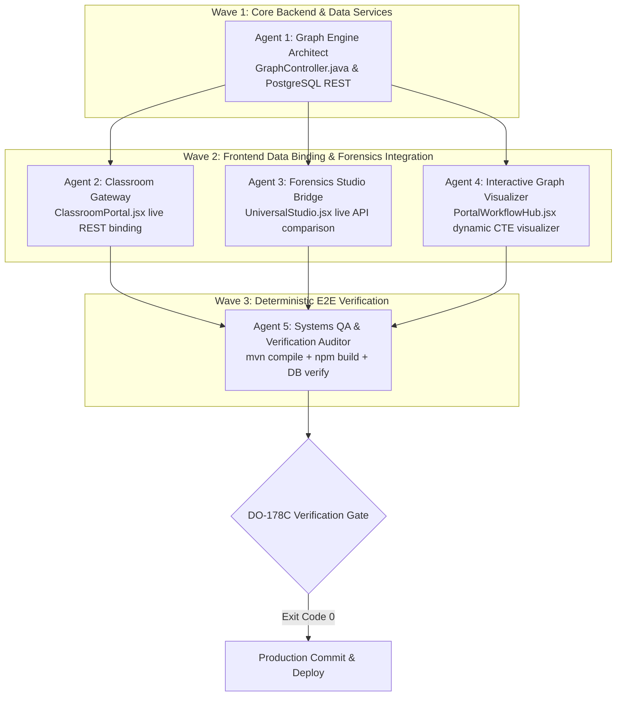

# Task Graph Specification (`GRAPH_SPEC.md`)
## Task 3: 5-Agent Autonomous Collaboration Graph

---

## 1. 5-Agent Allocation Matrix

| Agent | Role | Domain | Primary Deliverables | Verification Target |
| :---: | :--- | :--- | :--- | :--- |
| **Agent 1** | Graph Engine Architect | Spring Boot & PostgreSQL | `GraphController.java` (`/api/graph/collusion-chains`, `/api/graph/nodes`) | `.\mvnw.cmd compile` |
| **Agent 2** | Classroom Gateway Specialist | React & Spring Boot REST | Dynamic classroom/assignment/submission state in `ClassroomPortal.jsx` | `npm run build` |
| **Agent 3** | Forensics Studio Bridge | React & FastAPI Forensics | Live 1-to-1 diff & AI forensics hook in `UniversalStudio.jsx` | `npm run build` |
| **Agent 4** | Interactive Graph Visualizer | React & SVG Topology | Dynamic CTE graph rendering & node selection in `PortalWorkflowHub.jsx` | `npm run build` |
| **Agent 5** | Systems QA Auditor | Cross-Stack QA | Comprehensive verification report & Git micro-commits | Exit code 0 across all gates |
