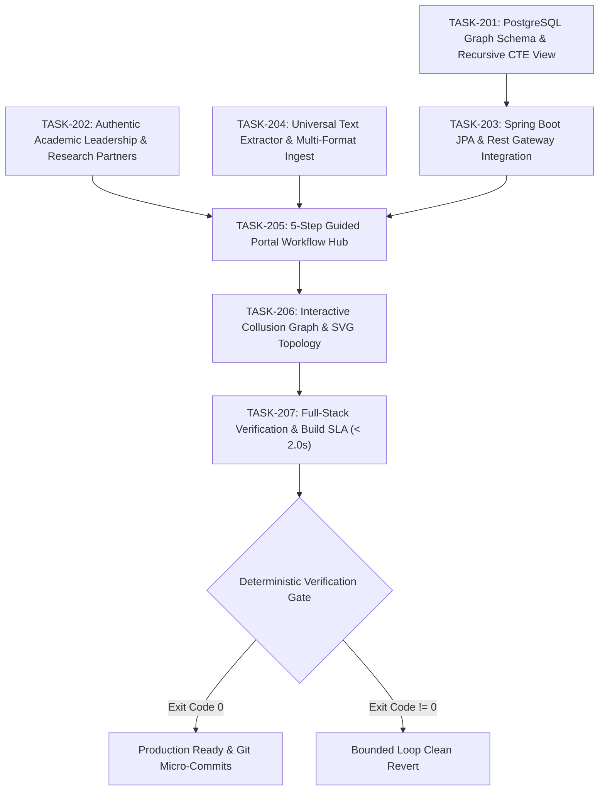

# Task Graph Specification (`GRAPH_SPEC.md`)
## Task 2: Veritas Universal Database Graph, Authentic Academic Consortia, Real Document Forensics & Guided Portal Workflow

---

## 1. Concurrent Dependency Waves

| Wave | Task ID | Assigned Agent | Objectives | Target Artifacts | Verification Command |
| :---: | :--- | :--- | :--- | :--- | :--- |
| **Wave 1** | `TASK-201` | Universal Graph & DB Architect | Schema, tables, recursive CTE view on port 2157 | `schema-postgresql.sql`, `seed-graph-data.sql` | `psql -c "SELECT * FROM view_collusion_chains"` |
| **Wave 1** | `TASK-202` | Authentic Leadership Specialist | Replace placeholder names with real academic consortia | `VeritasManifestoPage.jsx`, `index.html` | `npm run build` |
| **Wave 1** | `TASK-204` | Forensics Extractor Specialist | Real PDF/DOCX parsing (zero simulation) | `extractor.py`, `PortalWorkflowHub.jsx` | `python -c "import pypdf; print('OK')"` |
| **Wave 2** | `TASK-203` | Backend Integration Architect | Live Spring Boot REST APIs with PostgreSQL | `DataInitializer.java`, `application.properties` | `.\mvnw.cmd compile` |
| **Wave 3** | `TASK-205` | Guided Portal Workflow Specialist | 5-Step guided investigation pipeline | `PortalWorkflowHub.jsx`, `App.jsx`, `CommandPalette.jsx` | `npm run build` |
| **Wave 4** | `TASK-206` | Interactive UI/UX Specialist | Topological collusion graph SVG & live DB badge | `PortalWorkflowHub.jsx`, `OperationsDashboard.jsx` | `npm run build` |
| **Wave 5** | `TASK-207` | Systems QA & Benchmarker | E2E integration test, build time SLA < 2.0s | `dist/`, `VERIFICATION_REPORT.md` | `npm run build` |

---

## 2. Partitioning & Isolation Protocol
- All database modifications run on PostgreSQL cluster (port 2157, `veritasdb`).
- All backend REST interactions run on Spring Boot (port 8080).
- All AI forensics and extraction run on Python FastAPI (port 8000).
- Frontend builds and proxies run via Vite (port 5173).
