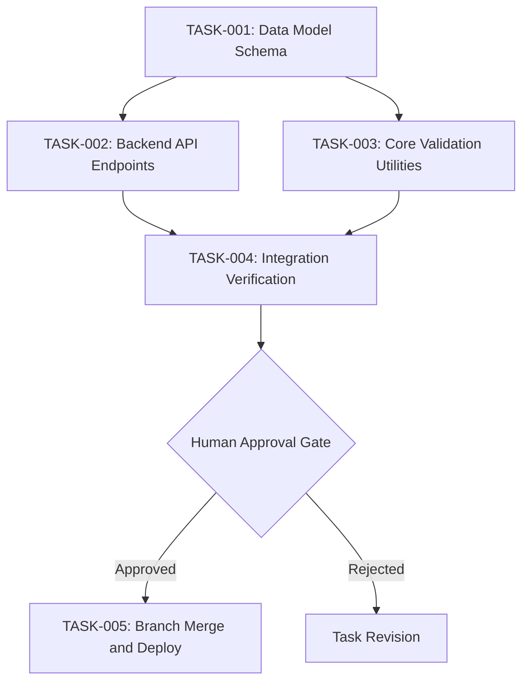

# Task Graph Specification (`GRAPH_SPEC.md`)

Use this document to define dependencies and concurrent execution across tasks.

## 1. Graph Overview (Mermaid)

## 2. Concurrency and Isolation Rules
- Independent tasks run concurrently in separate Git worktrees.
- Use `gnhf --worktree` for tasks without shared file writes.
- Do not run tasks concurrently if they edit the same files.
- Each task writes only to its declared output files.

## 3. Node Specifications

### Node: `TASK-001`
- **Objective**: Define core data models and types.
- **Dependencies**: None.
- **Inputs**: Requirements document.
- **Outputs**: `src/models/user.ts`.
- **Verification Command**: `npm run typecheck`.
- **Failure Behavior**: Halt dependent tasks `TASK-002` and `TASK-003`.

### Node: `TASK-002` (Concurrent Candidate)
- **Objective**: Implement API endpoints for user creation.
- **Dependencies**: `TASK-001`.
- **Inputs**: `src/models/user.ts`.
- **Outputs**: `src/api/user.ts`, `tests/api/user.test.ts`.
- **Worktree**: Isolated worktree branch `gnhf/task-002-api`.
- **Verification Command**: `npm test -- tests/api/user.test.ts`.
- **Failure Behavior**: Retry once, then log error and halt node.

### Node: `TASK-003` (Concurrent Candidate)
- **Objective**: Implement input validation utility functions.
- **Dependencies**: `TASK-001`.
- **Inputs**: `src/models/user.ts`.
- **Outputs**: `src/utils/validation.ts`, `tests/utils/validation.test.ts`.
- **Worktree**: Isolated worktree branch `gnhf/task-003-validation`.
- **Verification Command**: `npm test -- tests/utils/validation.test.ts`.
- **Failure Behavior**: Retry once, then log error and halt node.

### Node: `TASK-004` (Integration Gate)
- **Objective**: Merge worktrees and run full integration test suite.
- **Dependencies**: `TASK-002`, `TASK-003`.
- **Inputs**: Outputs from `TASK-002` and `TASK-003`.
- **Outputs**: Integrated branch `staging`.
- **Verification Command**: `npm run test:all`.
- **Failure Behavior**: Roll back merge and report conflict.

### Node: `TASK-005` (Human Approval Gate)
- **Objective**: Human engineer reviews code diffs in Antigravity IDE.
- **Action**: Accept or reject merge into `main`.
- **Rule**: Never deploy without explicit human sign-off.
